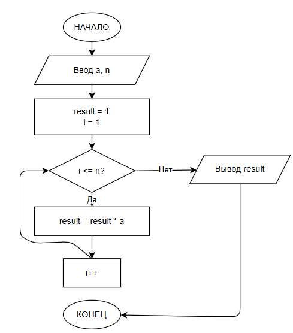

# Домашнее задание к работе 8

## Условие задачи
**Написать программу вычисления a^n — возведения числа a в целую степень n с использованием цикла. Программа должна поддерживать как положительные, так и отрицательные значения степени.**
---
### Блок-схема
 
### 1.Алгоритм
1. **Начало**
2. **Ввод данных:**
   - Считать основание $a$ (вещественное число)
   - Считать показатель степени $n$ (целое число)
3. **Инициализация:**
   - Установить `result = 1`
   - Вычислить `abs_n = |n|` (модуль показателя)
   - Установить счётчик `i = 1`
4. **Цикл (повторение):**
   - Пока `i <= abs_n`:
     - `result = result * a`
     - `i = i + 1`
5. **Обработка отрицательной степени:**
   - Если `n < 0`, то `result = 1 / result`
6. **Вывод результата:**
   - Вывести $a^n$ = result
7. **Конец**
## 2. Реализация программы

```c
#include <stdio.h>

int main() {
    double a, result = 1;
    int n;

    printf("Введите основание a: ");
    scanf("%lf", &a);
    printf("Введите степень n: ");
    scanf("%d", &n);

    int abs_n = n < 0 ? -n : n;

    for (int i = 1; i <= abs_n; i++) {
        result *= a;
    }

    if (n < 0) {
        result = 1 / result;
    }

    printf("%.2f^%d = %.6f\n", a, n, result);

    return 0;
}
## 3. Результаты работы программы
Введите основание a: 3
Введите степень n: 12
3,00^12 = 531441,000000
## 4. Информация о разработчике
Тухватулин Евгений Романович, бТИИ-261
